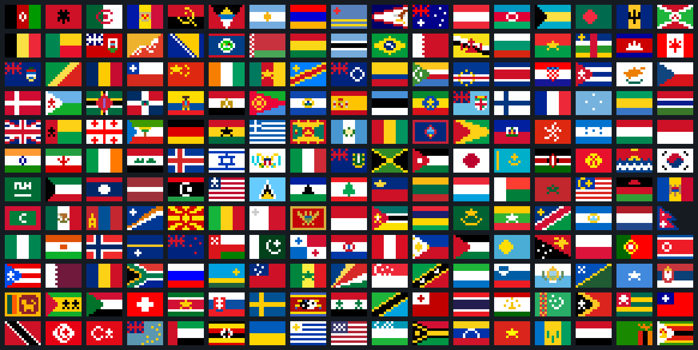

## Pixel Flags


A collection of tiny 15x10 pixel art flags. This repository contains 204 country flag icons, available in PNG and WebP:



### How to use

```
https://igor-couto.github.io/pixel-flags/flags/br.png
```
Replace `br` with the [ISO 3166-1 alpha-2](https://en.wikipedia.org/wiki/ISO_3166-1_alpha-2) code of a country.
The two-letter country codes are used most prominently for the Internet's country domains.

The default size is 15x10. Four larger sizes are also available: 30x20, 45x30, 60x40, and 75x50. To use them, add the resolution before the country code as shown below.

PNG:

```html


```

For WebP, use the same path with the `.webp` extension. The WebP versions preserve the PNG dimensions, colors, and transparency without loss. All original PNGs remain available.


Results in this:


### Author

- **Igor Couto** - [igor.fcouto@gmail.com](mailto:igor.fcouto@gmail.com)
